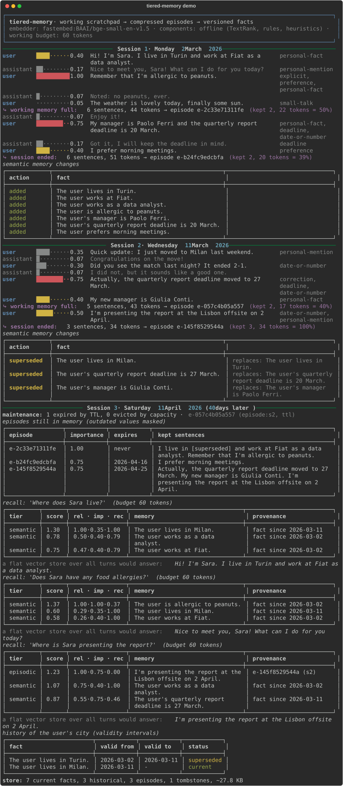
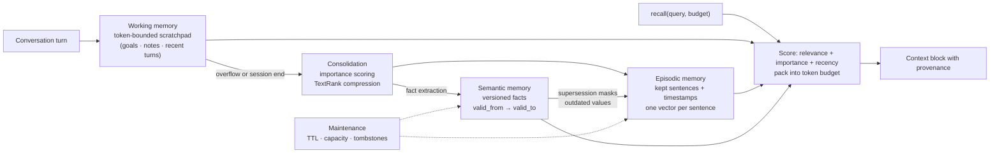
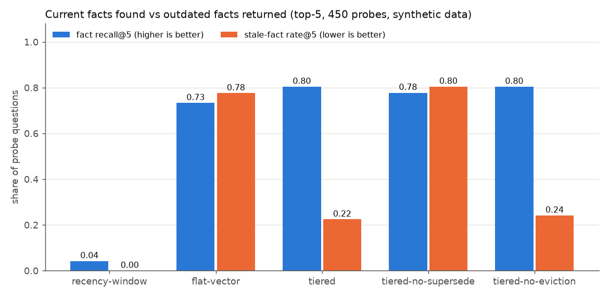
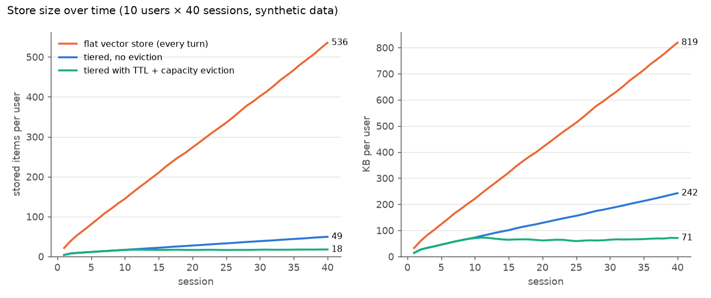

<p align="center">
  
</p>

<p align="center">
  <a href="https://github.com/iamsammy-ak/three-tier-agent-memory/actions/workflows/ci.yml"></a>
  
  
  
  <a href="LICENSE"></a>
</p>

**Three-Tier Agent Memory** (`tiered-memory`) gives an LLM agent a memory that works across sessions the way a good
assistant's would: a small working scratchpad for the current conversation, compressed episodes of past
conversations, and a store of facts that knows when a fact stopped being true. When the user says "I moved to
Milan", the agent stops recalling "lives in Turin", while the old value stays available as history.

On a seeded synthetic benchmark of 50 users × 10 sessions, it finds the current value of a fact more often than a
flat vector store over every turn (recall@5 0.80 vs 0.73) and returns outdated values far less often (0.22 vs 0.78
of changed facts; **0.00 when the offline fact extractor understood every statement**), with an eighth of the
stored items.

<p align="center">
  
</p>

## Why this exists

Chat agents usually remember in one of two ways, and both break over weeks of conversations:

- **Keep the recent history** and drop the rest when the context window fills. Anything said more than a session ago
  is gone: an allergy mentioned in March is unknown in May.
- **Embed every message in a vector store** and retrieve the nearest ones. Nothing is forgotten, but nothing is
  updated either. Ask "where does the user live?" and the store happily returns both "I live in Turin" and "I just
  moved to Milan", plus a friend who lives in Paris. The store also grows without bound.

Memory for agents needs what human memory does: a short-term buffer, a way to compress experiences, a way to turn
them into durable knowledge, a notion of what is important, and the ability to forget. This project implements that
as a small, inspectable library with an honest benchmark.

## Features

| | |
|---|---|
| 🧠 **Working memory** | Token-bounded scratchpad per session (goals, pinned notes, recent turns); overflow triggers consolidation |
| 🗜️ **Episodic compression** | Importance-biased TextRank keeps the sentences that matter, about a third of the raw tokens; an LLM summary when a key is set |
| 📚 **Semantic facts** | Subject–predicate–object facts with confidence, source episode and embedding; deduplication and merging |
| ⏳ **Supersession with history** | A newer contradicting fact closes the old one's validity interval (`valid_from` → `valid_to`) instead of deleting it; time-travel queries with `as_of` |
| ⭐ **Importance scoring** | Generative-Agents-style score: weighted relevance + importance + recency; importance from rules (explicit "remember", preferences, dates, corrections) or an LLM 1–10 rating |
| 🧹 **TTL and eviction** | Per-tier TTLs stretched by importance and reinforced on every access, capacity limits evicting the lowest retention first, content-free tombstones |
| 🎯 **Budget-aware recall** | `recall(query, budget_tokens)` merges all tiers, packs the best items into a token budget and returns scores and provenance |
| 💾 **Persistent and namespaced** | One SQLite file, vectors as BLOBs, brute-force cosine; any number of users or agents; survives restarts mid-session |
| 🔌 **CLI and HTTP API** | `demo`, `remember`, `recall`, `consolidate`, `inspect`, `ingest`, `forget`, `bench`, `serve` (FastAPI on port 8707) |

## How it works



1. **Observe.** Every turn is scored for importance and appended to the session's scratchpad in SQLite. When the
   scratchpad exceeds its token budget (320 tokens by default), the oldest turns are flushed to consolidation; goals
   and pinned notes stay until the session ends.
2. **Compress.** The flushed turns are split into sentences. Salient sentences (high importance, or ones that state a
   fact) are kept verbatim with their timestamps; TextRank, biased by importance, adds the most central remaining
   sentences up to about 35% of the raw tokens. Pure small talk is dropped at this point.
3. **Extract and reconcile facts.** User sentences go through the fact extractor (rules offline, an LLM when a key is
   set). Each candidate is merged into semantic memory: a repeat reinforces the existing fact (more mentions, higher
   confidence), a contradiction on a single-valued slot such as `lives_in` closes the old fact's validity interval and
   opens a new one, and a late-arriving older statement is filed as history without disturbing the present.
4. **Propagate.** Facts link back to the sentences that produced them. At recall time, values that are no longer true
   anywhere are masked as `[superseded]` inside episode text, so chatter like "it's been raining in Turin all week"
   stops leaking a city the user has left.
5. **Forget.** After each session, maintenance expires items whose TTL has passed and evicts the lowest-retention
   items when a tier is over capacity, leaving a tombstone (id, tier, reason, content hash, never the content).
6. **Recall.** Facts, best-matching episode sentences and the open scratchpad are scored, ranked and packed into the
   token budget, with provenance (tier, session, source episode, validity interval, confidence) on every item.

### Scoring, decay and retention

| Quantity | Definition |
|---|---|
| Retrieval score | (1.0 · relevance + 0.3 · importance + 0.2 · recency) × penalty; relevance and recency min-max normalised over the candidates, as in Generative Agents |
| Recency | 0.5 ^ (time since last access ÷ half-life); half-lives: working 1 h, episodes 7 days, facts 30 days |
| Strength (reinforcement) | 1 + ln(1 + accesses + extra mentions) |
| Expiry (TTL) | last access + TTL × (1 + 3 × importance) × strength; episodes 30 days, facts 180 days, history 90 days; importance ≥ 0.9 never expires |
| Retention (eviction order) | 0.5 · importance + 0.4 · decayed strength + 0.1 · confidence; history facts count half |
| Penalty | × 0.5 for an episode snippet with masked outdated values and for superseded facts in history mode |

## Benchmarks

Synthetic, seeded data generated by [`bench/synthetic.py`](src/tiered_memory/bench/synthetic.py): **50 users × 10
sessions** (7,568 turns, sessions 3–12 days apart). Each user states a city, employer, manager, project deadline,
meeting preference, favourite cuisine, an allergy, a dog's name and an upcoming talk; cities, jobs, managers,
deadlines and preferences change over time. Most turns are distractors: small talk, questions, facts about friends
("my friend lives in Paris") and hypotheticals ("I might move to Berlin"). After the last session, **450 probe
questions** ask for the current value of every fact. Embeddings: `BAAI/bge-small-en-v1.5` via fastembed. All
components run offline (rule-based extractor, TextRank, heuristic importance). Defaults were tuned on seed 1; the
numbers below use seed 7.

| System | Recall@5 ↑ | Stale@5 ↓ | Recall @200 tokens ↑ | Recall: changed / stable / event | Items per user | KB per user |
|---|---:|---:|---:|---|---:|---:|
| Recency window (last turns) | 0.042 | 0.000 | 0.227 | 0.08 / 0.02 / 0.02 | 151.4 | 4.4 |
| Flat vector store (every turn) | 0.733 | 0.776 | 0.849 | 0.61 / 0.87 / 0.52 | 151.4 | 231.5 |
| **Tiered (this project)** | **0.804** | **0.224** | **0.878** | 0.84 / 0.83 / 0.58 | **19.5** | **79.3** |
| Tiered without supersession | 0.778 | 0.805 | 0.878 | 0.82 / 0.81 / 0.50 | 19.5 | 79.3 |
| Tiered without eviction | 0.804 | 0.241 | 0.878 | 0.84 / 0.83 / 0.58 | 19.7 | 81.3 |

- **Recall@5**: the current value appears in the top 5 returned items. **Stale@5**: for the 174 facts that changed,
  an outdated value appears in the top 5. Recall @200 tokens packs as much as fits in a 200-token context.
- **Where the remaining stale answers come from.** Split by whether every statement of a changed fact used a phrasing
  the rule-based extractor understands: stale@5 is **0.000** on those 96 probes and 0.500 on the 78 probes where at
  least one statement did not ("these days home is Lyon"), because a missed update leaves the old fact current. The
  flat vector store scores 0.802 and 0.744 on the same splits. The extractor finds 100% of facts in covered
  phrasings with 100% precision and, by design, none in the uncovered ones (77% overall); an LLM extractor is the
  intended fix.
- **Supersession is what removes stale answers**: switching it off sends stale@5 from 0.22 to 0.81.
- **Eviction is nearly free here**: within ten sessions it changes recall by less than a point. Over a longer horizon
  it keeps the store flat (chart below).
- **Latency** (retrieval only, best of 3 per question, on a busy laptop): tiered p50 1.7 ms (p95 4.5 ms), flat
  0.2 ms; embedding the question adds a median 24 ms for every embedding-based system, so brute-force search is not
  the bottleneck at this scale.





Over **40 sessions** (10 users, seed 8), the tiered store with eviction levels off at about 18 items (71 KB) per user,
while it keeps growing without eviction (49 items, 242 KB) and the flat store reaches 536 items (819 KB).

Reproduce (5 to 10 minutes on a laptop; the first run downloads the 66 MB embedding model):

```bash
python -m tiered_memory bench --users 50 --sessions 10 --seed 7 --embedder fastembed --k 5 --budget 200 --growth-users 10 --growth-sessions 40
```

Full results: [`benchmarks/results/benchmark.md`](benchmarks/results/benchmark.md) and
[`benchmark.json`](benchmarks/results/benchmark.json). Assumptions and caveats: the conversations are
template-generated, the probes are answered by whole-word string matching against the returned items (no LLM in
the loop), and the rule-based extractor was written knowing the template families, which is why the results are
split by extraction coverage. Probes do not reinforce memories (`reinforce=False`), so eviction is measured without
the protection that real, repeated use would give.

## Quick start

```bash
git clone https://github.com/iamsammy-ak/three-tier-agent-memory.git
cd three-tier-agent-memory
python -m venv .venv
source .venv/bin/activate          # Windows: .venv\Scripts\activate
pip install -e ".[dev]"            # add ",models" for the real embedding model
python -m tiered_memory demo       # three scripted sessions, offline, a few seconds
```

The CLI stores memories in `.tiered-memory/memory.db` (or `--db PATH`, or `TIERED_MEMORY_DB`):

```bash
tiered-memory remember "I'm allergic to peanuts" --user sara
tiered-memory ingest examples/transcript.jsonl --user sara        # replay a JSONL transcript
tiered-memory recall "Where does Sara live?" --user sara --budget 120
tiered-memory recall "Where does Sara live?" --user sara --history --json
tiered-memory consolidate --user sara --now 2027-06-01            # TTL + eviction as of a future date
tiered-memory inspect --user sara --history                       # facts, episodes, tombstones
tiered-memory serve --port 8707                                   # HTTP API (FastAPI)
```

Everything works without an API key. To let an LLM write episode summaries, extract facts and rate importance, copy
`.env.example` to `.env` and set a free [OpenRouter](https://openrouter.ai/keys) key:

| Variable | Purpose |
|---|---|
| `OPENROUTER_API_KEY` | Enables LLM summaries, fact extraction and importance ratings (offline rules otherwise) |
| `OPENROUTER_MODELS` | Optional comma-separated model list, tried in order on rate limits and errors |

`--offline` forces the offline components even when a key is set. Replies are cached on disk under `.cache/llm`.

## Use it as a library

```python
import tempfile
from pathlib import Path

from tiered_memory import ManualClock, MemorySystem

clock = ManualClock(1_772_442_000)  # 2 March 2026, 09:00 UTC; omit it to use wall-clock time

with tempfile.TemporaryDirectory() as tmp, MemorySystem.open(
    Path(tmp) / "memory.db", namespace="user:sara", clock=clock
) as memory:
    sid = memory.start_session(goal="Help Sara plan her week")
    memory.observe(sid, "user", "I live in Turin and the quarterly report deadline is 20 March.")
    memory.observe(sid, "assistant", "Noted!")
    memory.end_session(sid)  # working memory -> episode -> facts

    clock.advance(days=9)
    sid = memory.start_session()
    memory.observe(sid, "user", "I just moved to Milan. Actually, the report deadline moved to 27 March.")
    memory.end_session(sid)  # the new facts supersede the old ones

    result = memory.recall("Where does Sara live and when is the report due?", budget_tokens=60)
    for item in result.items:
        print(f"{item.tier:9} {item.score.total:.2f}  {item.text}")
    print(result.as_context())
```

Output (from [`examples/quickstart.py`](examples/quickstart.py), real embedding model):

```text
semantic  1.43  The user's quarterly report deadline is 27 March.
episodic  1.12  Help Sara plan her week
semantic  0.30  The user lives in Milan.

## Known facts
- The user's quarterly report deadline is 27 March. (since 2026-03-11)
- The user lives in Milan. (since 2026-03-11)

## Relevant past conversations
- [2026-03-02] Help Sara plan her week
```

"The report deadline" was matched to the known "quarterly report" task, and the Turin fact is still there as history
(`memory.history("lives_in")`). Other useful calls: `memory.remember(text)` for explicit memories (protected from
TTL), `memory.maintain()` for TTL and eviction, `memory.forget(item_id)` (a forgotten fact is never re-learned),
`memory.semantic.as_of(timestamp)` for time travel, and `MemoryConfig(...)` for every budget, TTL and weight.

**HTTP API** (`tiered-memory serve`, port 8707): `POST /v1/{namespace}/sessions`, `.../sessions/{id}/turns`,
`.../sessions/{id}/end`, `POST /v1/{namespace}/remember`, `POST /v1/{namespace}/recall`,
`POST /v1/{namespace}/maintain`, `GET /v1/{namespace}/facts?history=true`, `GET /v1/{namespace}/stats` and
`DELETE /v1/{namespace}/items/{id}`. Interactive docs at `/docs`.

## Design decisions

- **Close facts, don't overwrite them.** Contradictions set `valid_to` on the old fact and link it to its
  replacement. *Alternative:* update in place (simpler) or keep every version as current (what a vector store does).
  Validity intervals keep recall clean while preserving an audit trail and "as of" queries, at the cost of a little
  interval bookkeeping (out-of-order statements are tested with property-based tests).
- **Cardinality decides what a contradiction is.** `lives_in` and `deadline:<task>` hold one value; `likes` holds
  many and only conflicts with `dislikes` on the same object. *Alternative:* ask an LLM to judge every pair, which is
  slower, costs tokens and is hard to test. The predicate vocabulary is small and explicit; unknown predicates
  default to multi-valued, which never deletes information by mistake.
- **Supersession reaches the episodes.** Fact-bearing sentences are left to the semantic tier, and outdated values are
  masked inside other episode text. *Alternative:* re-summarise old episodes when facts change (expensive) or accept
  stale snippets. Masking is cheap and explainable; history mode shows the raw text.
- **Episodes are indexed by sentence, not as one vector.** A question about a single remark should not have to
  match the average of a whole conversation. Recall returns the best one or two sentences of an episode as a
  snippet, which also uses the token budget better than whole transcripts.
- **Offline first, LLM optional.** Every LLM-backed component (summary, extraction, importance) has a deterministic
  stand-in and falls back to it on any error. *Alternative:* LLM-only, which makes tests flaky and the benchmark
  expensive. The cost is weaker extraction, measured and reported separately.
- **SQLite with brute-force cosine.** One file, transactional, namespaced, inspectable with any SQLite browser.
  *Alternative:* a vector database. A personal memory stays small (about 20 items and 80 KB per user in the
  benchmark, where a whole recall takes about 2 ms), so an approximate index would add a dependency without a
  measurable gain at this scale.

## Project structure

```
three-tier-agent-memory/
├── src/tiered_memory/
│   ├── memory.py          MemorySystem facade: sessions, recall, maintenance, forget
│   ├── working.py         token-bounded scratchpad and overflow
│   ├── consolidation.py   working → episodic → semantic pipeline
│   ├── compression.py     importance-biased TextRank; LLM summariser
│   ├── extraction.py      rule-based and LLM fact extraction
│   ├── semantic.py        dedup, merging, supersession, validity intervals
│   ├── predicates.py      predicate vocabulary, cardinality, rendering
│   ├── importance.py      heuristic and LLM importance
│   ├── retrieval.py       cross-tier scoring, masking, budget packing
│   ├── eviction.py        TTL, capacity eviction, tombstones
│   ├── scoring.py         recency, strength, retention, expiry
│   ├── store.py           SQLite persistence and vector BLOBs
│   ├── embeddings.py      fastembed bge-small and hashing fallback
│   ├── llm.py             OpenRouter client with fallback, cache, JSON repair
│   ├── tokens.py          token counting (approximate or tiktoken)
│   ├── server.py · cli.py · demo.py
│   └── bench/             synthetic generator, baselines, runner, charts
├── tests/                 119 tests (unit, property-based, CLI, HTTP)
├── benchmarks/            run_benchmark.py and results/ (JSON + Markdown)
├── examples/              quickstart.py, transcript.jsonl
└── assets/                banner, demo recording, charts
```

## Testing

```bash
pip install -e ".[dev]"
ruff check . && mypy && pytest -q
```

The suite covers the extractor (including negatives: hypotheticals, questions, other people), supersession and
history (a Hypothesis property test feeds statements in random order and checks that validity intervals never
overlap and exactly one value is current), budget packing (never exceeds the budget), TTL, capacity eviction,
tombstones and the right to be forgotten, persistence across restarts, namespace isolation, the LLM components with
a scripted model (JSON repair and fallback), the CLI and the HTTP API. Tests never call an LLM and never download a
model; a test of the real embedding model runs only when it is already cached. CI runs on Python 3.10 and 3.12.

## Limitations

- The rule-based extractor covers common first-person phrasings only; anything else is kept as episodic text, not as
  a fact, and cannot supersede an older fact. That is where most remaining stale answers come from.
- The benchmark is synthetic and template-based, and its probes are scored by string matching rather than by an
  agent answering questions. It compares memory designs; it does not predict accuracy on real conversations.
- Subjects other than the user ("my sister lives in Rome") are not extracted as facts, and contradiction handling
  relies on the predicate vocabulary rather than on general reasoning.
- The token counter is an approximation unless `MemoryConfig(token_counter="tiktoken")` is used.
- Brute-force search is right for per-user memories of thousands of items, not for millions.

## Roadmap

- [ ] Benchmark the LLM extractor and summariser against the rules once a key is available
- [ ] Reflection: periodic LLM summaries that turn related episodes into higher-level facts
- [ ] Facts about third parties (the user's manager's preferences, a partner's birthday)
- [ ] Optional approximate-nearest-neighbour index for very large namespaces

## License

[MIT](LICENSE) © 2026 Abhishek Kumar
